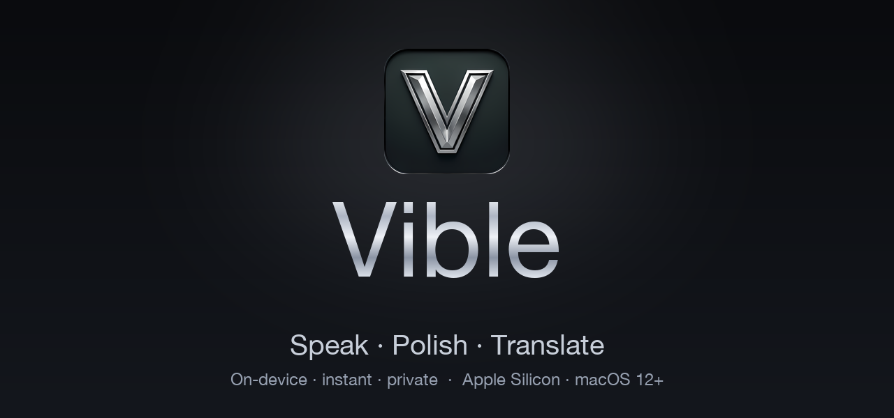

[English](README.md) · [繁體中文](README.zh-Hant.md) · [简体中文](README.zh-Hans.md) · [日本語](README.ja.md) · [한국어](README.ko.md) · **Español** · [Français](README.fr.md) · [Deutsch](README.de.md)

# Vible — Tu voz, pulida hasta convertirse en texto perfecto

**Habla. Pule. Traduce.** En el dispositivo, al instante y en privado — una capa de voz completa para tu Mac.

 

[-C7CED9?style=for-the-badge&labelColor=0A0B0E)](https://github.com/Algohash-inc/Vible/releases/latest/download/Vible.dmg)

[**Sitio web**](https://vible.space) · [**Descargar**](https://github.com/Algohash-inc/Vible/releases/latest/download/Vible.dmg) · [**Guía de configuración**](#-instalación) · [**Preguntas frecuentes**](#-preguntas-frecuentes)

Vible convierte tu voz en texto limpio, corregido y traducido **en cualquier app** — a la velocidad del pensamiento. Los modelos locales te dan velocidad y privacidad en Apple Silicon; activa un solo interruptor para obtener la potencia de la GPU en la nube cuando la necesites. Mantén pulsado un atajo, habla, suelta — Vible transcribe, corrige tu gramática, traduce e incluso puede leerlo en voz alta.

---

## ✨ Lo más destacado

- ⚡ **A la velocidad del pensamiento** — Mantén pulsado `⌃⌘`, habla, suelta. Whisper local transcribe al instante y el texto pulido se pega directamente en la app en la que estés.
- 🧹 **Pulido gramatical automático** — Cada transcripción se limpia antes de aparecer: puntuación, mayúsculas y muletillas ("eh", "mmm", "o sea") desaparecen.
- 🌍 **Traducción en vivo, más de 20 idiomas** — Habla en un idioma, escribe en otro. Modo de conversación bidireccional para un intercambio en tiempo real.
- ⌘ **Traduce en cualquier lugar con doble toque de `⌘C`** — Selecciona texto en cualquier app, pulsa `⌘C` dos veces y una ventana emergente lo traduce ahí mismo — copia, escucha o reemplaza tu selección.
- 🗣️ **Texto a voz natural + clonación de voz** — Lee cualquier cosa en voz alta con voces de calidad de estudio, o graba 30 segundos y haz que Vible lo lea con *tu propia* voz.
- 🪶 **En el dispositivo por defecto** — Los modelos locales **MLX + ONNX** se ejecutan en Apple Silicon. Rápidos, con capacidad sin conexión y privados — tu audio nunca tiene que salir de tu Mac.
- ☁️ **La nube cuando la quieras** — Un solo interruptor activa modelos con GPU: sin descargas, sin tiempo de calentamiento, voces neuronales más ricas.
- 🔒 **Privado y cifrado** — Nada se sube a menos que actives la nube. Los datos en el dispositivo y en tránsito están cifrados; tu voz y tu texto nunca se venden, comparten ni usan para entrenamiento.
- 🍎 **Firmado y notarizado** — Creado para Apple Silicon, firmado por **Algohash Inc.** y notarizado por Apple — se abre sin advertencia de seguridad.

---

## 🎙️ El ciclo de voz — un atajo, cuatro superpoderes

Mantén pulsada la tecla, habla, suelta. Esa es toda la interacción.

| | Paso | Qué ocurre |
|---|---|---|
| 1 | **Captura** | Mantén pulsado `⌃⌘` en cualquier lugar y habla — una forma de onda en vivo muestra que está escuchando. |
| 2 | **Transcribe** | Whisper local convierte el habla en texto sin procesar al instante, en el dispositivo. |
| 3 | **Pule** | La gramática, las mayúsculas y las muletillas se limpian en una sola pasada. |
| 4 | **Traduce / Lee** | Opcionalmente traduce, luego pega automáticamente en tu app — o léelo en voz alta. |

> Hablas ~3× más rápido de lo que escribes. Vible hace que esa velocidad sea aprovechable en cada campo de texto de tu Mac.

---

## ⌘ Traduce cualquier cosa, justo donde estás

Sin ventana que abrir, nada que pegar:

1. **Selecciona** cualquier texto en cualquier app — Mail, Slack, un PDF, el navegador.
2. **Toca dos veces `⌘C`** — rápido. Vible detecta la copia y una ventana emergente aparece justo en tu cursor.
3. **Elige idioma y tono** — el idioma de origen se detecta automáticamente; elige tu idioma de destino y el tono (*formal*, *natural* o *con pronunciación*), luego **Copia**, **Lee** en voz alta o **Reemplaza** sobre tu selección ahí mismo.

`Más de 20 idiomas` · `Formal / natural` · `Reemplazo en el sitio`

---

## 🗣️ Tres formas de hacerte oír

| Voz | Nivel | Descripción |
|---|---|---|
| **Estándar** | En el dispositivo · gratis | TTS local nítido que funciona sin conexión en Apple Silicon — lecturas instantáneas y privadas. |
| **Premium** | GPU en la nube | Voces neuronales de calidad de estudio con emoción en más de 20 idiomas, transmitidas desde la nube. |
| **Clonación de voz zero-shot** | Studio | Graba 30 segundos y Vible lee cualquier cosa con *tu propia* voz. |

---

## 🔒 Privado por defecto

Vible funciona **totalmente en local** — la conversión de voz a texto y de texto a voz se ejecutan por completo en Apple Silicon mediante **MLX & ONNX**. Sin internet, sin servidores, nada que se pueda filtrar — privado incluso con el Wi-Fi apagado.

- ✅ Funciona completamente sin conexión
- ✅ Nada se sube — nunca (a menos que actives la nube)
- ✅ Cifrado en el dispositivo **y** en tránsito (TLS)

¿Necesitas el máximo rendimiento y las voces neuronales más ricas? Activa un solo interruptor para la **nube con GPU** — síntesis instantánea, sin tiempo de calentamiento. En cualquier caso, tus datos están cifrados y nunca se usan para entrenamiento.

---

## 📊 Escribir es lento. Vible no.

| Capacidad | Escribir | Dictado genérico | **Vible** |
|---|:---:|:---:|:---:|
| Velocidad de entrada sin procesar | ~40 ppm | ~120 ppm | **~150 ppm** |
| Gramática y puntuación automáticas | manual | — | **✓** |
| Traducción integrada | — | — | **✓ más de 20 idiomas** |
| Funciona en todas las apps | ✓ | algunas | **✓ en todo el sistema** |
| Funciona sin conexión / en el dispositivo | ✓ | solo en la nube | **✓ + nube** |
| Lee los resultados en voz alta (TTS) | — | — | **✓ + clonación de voz** |

---

## 🌍 Idiomas

**Interfaz (8):** English · 繁體中文 · 简体中文 · 日本語 · 한국어 · Español · Français · Deutsch

**Traducción y voz:** más de 20 idiomas, con un modo de conversación bidireccional.

---

## 🚀 Instalación

> [**⬇ Download Vible.dmg**](https://github.com/Algohash-inc/Vible/releases/latest/download/Vible.dmg) — luego sigue los pasos en tu idioma a continuación.

<b>English</b>

1. **Download** [`Vible.dmg`](https://github.com/Algohash-inc/Vible/releases/latest/download/Vible.dmg).
2. **Open** the downloaded `Vible.dmg` (double-click it).
3. **Drag** the **Vible** icon onto the **Applications** folder in the window that appears.
4. **Launch** Vible from Applications or Launchpad. It's signed and notarized by Apple, so it opens with **no security warning**.
5. **Grant the mic** — allow microphone + input monitoring once. Nothing leaves your Mac unless you turn cloud on.
6. **Hold `⌃⌘` and talk** — release, and the polished text pastes right where your cursor is. On first launch, Vible sets up its on-device models — give it a moment.

<b>繁體中文</b>

1. **下載** [`Vible.dmg`](https://github.com/Algohash-inc/Vible/releases/latest/download/Vible.dmg)。
2. **打開** 下載好的 `Vible.dmg`（雙擊它）。
3. 在彈出的視窗中，把 **Vible** 圖示**拖曳**到 **Applications（應用程式）**資料夾。
4. 從「應用程式」或 Launchpad **啟動** Vible。它已由 Apple 簽署並公證，因此開啟時**不會有任何安全警告**。
5. **授予麥克風權限** — 允許「麥克風」與「輸入監控」一次。除非你開啟雲端，否則資料不會離開你的 Mac。
6. **按住 `⌃⌘` 說話** — 放開後，整理好的文字會貼到游標所在處。首次啟動時，Vible 會設定本機模型，請稍候片刻。

<b>简体中文</b>

1. **下载** [`Vible.dmg`](https://github.com/Algohash-inc/Vible/releases/latest/download/Vible.dmg)。
2. **打开** 下载好的 `Vible.dmg`（双击它）。
3. 在弹出的窗口中，把 **Vible** 图标**拖到** **Applications（应用程序）**文件夹。
4. 从「应用程序」或 Launchpad **启动** Vible。它已由 Apple 签名并公证，因此打开时**不会出现任何安全警告**。
5. **授予麦克风权限** — 允许「麦克风」与「输入监控」一次。除非你开启云端，否则数据不会离开你的 Mac。
6. **按住 `⌃⌘` 说话** — 松开后，整理好的文字会粘贴到光标所在处。首次启动时，Vible 会设置本地模型，请稍候片刻。

<b>日本語</b>

1. [`Vible.dmg`](https://github.com/Algohash-inc/Vible/releases/latest/download/Vible.dmg) を **ダウンロード** します。
2. ダウンロードした `Vible.dmg` を **開きます**（ダブルクリック）。
3. 表示されたウインドウで、**Vible** アイコンを **「アプリケーション」フォルダ** に **ドラッグ** します。
4. 「アプリケーション」または Launchpad から Vible を **起動** します。Apple の署名・公証済みなので、**警告なしで** 開きます。
5. **マイクを許可** — 「マイク」と「入力監視」を一度だけ許可します。クラウドを有効にしない限り、データが Mac の外に出ることはありません。
6. **`⌃⌘` を押しながら話す** — 離すと、整えられたテキストがカーソル位置に貼り付けられます。初回起動時、Vible は端末内モデルを設定します。少しお待ちください。

<b>한국어</b>

1. [`Vible.dmg`](https://github.com/Algohash-inc/Vible/releases/latest/download/Vible.dmg) 를 **다운로드**합니다.
2. 다운로드한 `Vible.dmg` 를 **엽니다**(더블 클릭).
3. 나타나는 창에서 **Vible** 아이콘을 **응용 프로그램(Applications)** 폴더로 **드래그**합니다.
4. 응용 프로그램 또는 Launchpad에서 Vible 을 **실행**합니다. Apple의 서명·공증을 받았으므로 **보안 경고 없이** 열립니다.
5. **마이크 권한 허용** — '마이크'와 '입력 모니터링'을 한 번 허용합니다. 클라우드를 켜지 않는 한 데이터가 Mac을 떠나지 않습니다.
6. **`⌃⌘` 를 누른 채 말하기** — 손을 떼면 다듬어진 텍스트가 커서 위치에 붙여넣어집니다. 처음 실행 시 Vible 은 온디바이스 모델을 설정합니다. 잠시 기다려 주세요.

<b>Español</b>

1. **Descarga** [`Vible.dmg`](https://github.com/Algohash-inc/Vible/releases/latest/download/Vible.dmg).
2. **Abre** el `Vible.dmg` descargado (haz doble clic).
3. **Arrastra** el icono de **Vible** a la carpeta **Aplicaciones** en la ventana que aparece.
4. **Inicia** Vible desde Aplicaciones o Launchpad. Está firmado y notarizado por Apple, así que se abre **sin ninguna advertencia de seguridad**.
5. **Concede el micrófono** — permite el micrófono y la monitorización de entrada una vez. Nada sale de tu Mac salvo que actives la nube.
6. **Mantén `⌃⌘` y habla** — al soltar, el texto pulido se pega justo donde está tu cursor. En el primer inicio, Vible configura sus modelos en el dispositivo; espera un momento.

<b>Français</b>

1. **Téléchargez** [`Vible.dmg`](https://github.com/Algohash-inc/Vible/releases/latest/download/Vible.dmg).
2. **Ouvrez** le `Vible.dmg` téléchargé (double-cliquez).
3. **Faites glisser** l'icône **Vible** vers le dossier **Applications** dans la fenêtre qui s'affiche.
4. **Lancez** Vible depuis Applications ou le Launchpad. Il est signé et notarisé par Apple, il s'ouvre donc **sans aucun avertissement de sécurité**.
5. **Autorisez le micro** — autorisez le microphone et la surveillance des entrées une fois. Rien ne quitte votre Mac sauf si vous activez le cloud.
6. **Maintenez `⌃⌘` et parlez** — au relâchement, le texte nettoyé se colle là où se trouve votre curseur. Au premier lancement, Vible configure ses modèles sur l'appareil ; patientez un instant.

<b>Deutsch</b>

1. **Lade** [`Vible.dmg`](https://github.com/Algohash-inc/Vible/releases/latest/download/Vible.dmg) herunter.
2. **Öffne** die heruntergeladene `Vible.dmg` (Doppelklick).
3. **Ziehe** das **Vible**-Symbol im erscheinenden Fenster auf den Ordner **Programme (Applications)**.
4. **Starte** Vible über Programme oder das Launchpad. Es ist von Apple signiert und notarisiert und öffnet sich **ohne Sicherheitswarnung**.
5. **Mikrofon erlauben** — erlaube Mikrofon + Eingabeüberwachung einmalig. Nichts verlässt deinen Mac, außer du aktivierst die Cloud.
6. **Halte `⌃⌘` und sprich** — beim Loslassen wird der bereinigte Text direkt an der Cursorposition eingefügt. Beim ersten Start richtet Vible seine geräteinternen Modelle ein – einen Moment Geduld.

> Si macOS alguna vez dice que la app "no se puede abrir", haz clic derecho en Vible dentro de Aplicaciones → **Abrir** → **Abrir**. Esto solo ocurre si la descarga se interrumpió — volver a descargarla lo soluciona.

---

## 🖥️ Requisitos

- Un Mac con **Apple Silicon** (M1 o posterior)
- **macOS 12 Monterey** o más reciente
- ~600 MB de descarga · se instala en segundos · **Windows y Linux próximamente**

---

## 💳 Planes

| | Free | Pro | Studio |
|---|---|---|---|
| Dictado por voz en el dispositivo | ✓ | ✓ | ✓ |
| Pulido gramatical | ✓ | ✓ | ✓ |
| Traducción | básica | más de 20 idiomas + conversación | más de 20 idiomas + conversación |
| Voces | Estándar | + Premium / emoción | + Clonación de voz |
| Velocidad de GPU en la nube | — | ✓ | ✓ |
| Modo agente y acciones con herramientas | — | — | ✓ |

Las funciones en el dispositivo son tuyas para siempre, gratis. Paga solo cuando quieras la velocidad de la GPU en la nube y uso ilimitado. Consulta [vible.space](https://vible.space) para ver los precios actuales.

---

## ❓ Preguntas frecuentes

<b>¿De verdad funciona en el dispositivo?</b>

Sí. Los modelos predeterminados de voz a texto y de texto a voz se ejecutan localmente en Apple Silicon mediante MLX y ONNX — rápidos y con capacidad sin conexión. La GPU en la nube es opcional, se activa con un solo interruptor cuando quieras voces más ricas o la máxima velocidad.

<b>¿Qué Macs son compatibles?</b>

Cualquier Mac con Apple Silicon (M1 o posterior) con macOS 12 o más reciente. La app está firmada y notarizada. Las versiones para Windows y Linux están en la hoja de ruta.

<b>¿Vible funciona en todas las apps?</b>

Sí — funciona en todo el sistema. Mantén pulsado el atajo en cualquier campo de texto (Mail, Slack, tu editor, el navegador) y el resultado pulido se pega justo donde está tu cursor.

<b>¿Puede hablar con mi propia voz?</b>

Con el plan Studio puedes grabar una muestra corta y Vible leerá el texto con un clon de tu voz, junto a las voces neuronales estándar y premium.

---

**[vible.space](https://vible.space)**  ·  Speak. Polish. Translate.

Copyright © 2026 **Algohash Inc.** · Vible is a signed, notarized macOS application. All rights reserved.

